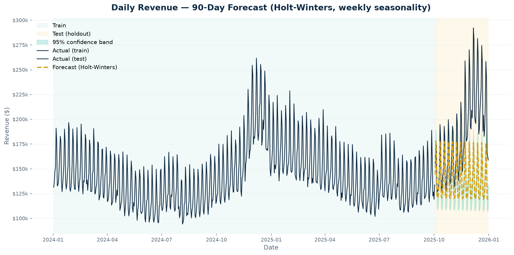
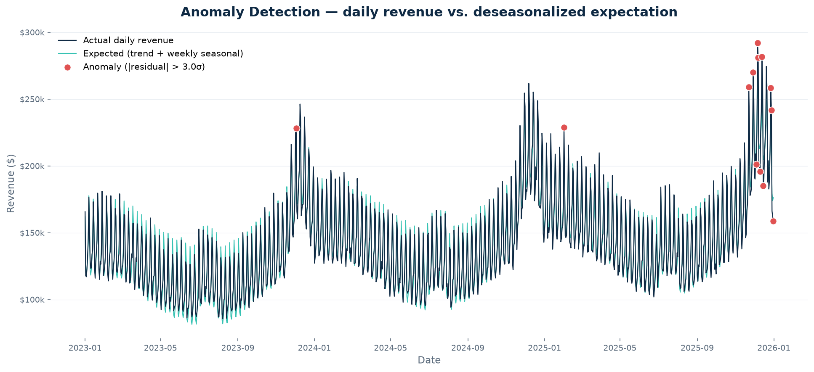
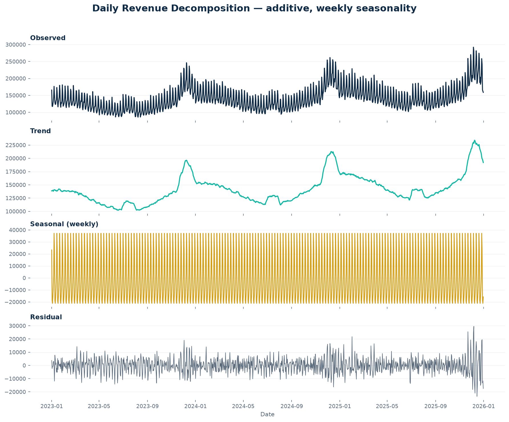
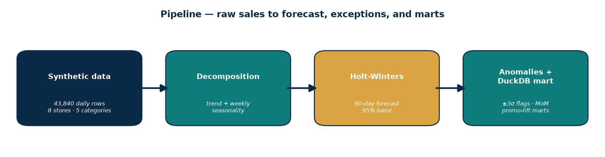

# Retail Sales Forecasting


> **The sales data here is fully synthetic** — I generated it with `data/generate_data.py` (fixed seed 42, so it's reproducible). ~3 years of daily sales (2023–2025) across 8 stores and 5 product categories, 43,840 rows, with weekly seasonality, yearly seasonality, an ~11%/year trend, promotional periods, and a few injected anomalies. No real company data, no real customers.

## The business questions

1. *"How much do we need 90 days out?"* — inventory planning lives or dies on the forecast.
2. *"Are our promotions actually earning their keep?"* — promo spend needs a per-category ROI answer, not vibes.

This project does both: a validated 90-day forecast with anomaly detection, plus a SQL analytics mart for month-over-month performance and promo lift.

## What the numbers say

**Forecast accuracy — validated on a true holdout (final 90 days of 2025), not in-sample:**

| Metric | Value |
| --- | ---: |
| MAE | 45,334 |
| RMSE | 55,894 |
| MAPE | **22.31%** |

- The December holiday spike is most of the error — a weekly-seasonality model structurally underfits the year's biggest weeks. That's the honest caveat, and it's exactly why the next iteration should be promo/holiday-aware.
- The 95% confidence band widens meaningfully at the 90-day tail — the chart shows the uncertainty instead of hiding it.



Train in teal, holdout test in cream, forecast as the gold dashed line with a 95% confidence band. ([Interactive version](outputs/forecast_interactive.html) — open in a browser after cloning, hover tooltips included.)

**Promotions, ranked by lift:**

| Category | Promo lift |
| --- | ---: |
| Electronics | **+8.34%** |
| Apparel | +8.03% |
| Grocery | +7.84% |
| Home & Living | +7.70% |
| Beauty | +5.40% |

Every category lifts, but if promo budget is finite, it now has a ranking — Electronics earns its spend almost 1.5× over Beauty.

**Anomalies:** 13 days flagged by residual analysis — the Black Friday rush, a store closure, and other genuine exceptions. That's the weekly exception report a planning team would actually review.



**The mart** answers "how did we do vs last month" for every store × category — all queryable in the committed `outputs/retail_mart.duckdb`.

| Mart | Rows | What it answers |
| --- | ---: | --- |
| `mart_daily_sales` | 1,096 | daily totals across all stores |
| `mart_store_category_monthly` | 1,440 | MoM revenue growth per store × category |
| `mart_promo_lift` | 5 | promo lift ranking by category |



## Why I built it this way



- **Holt-Winters exponential smoothing** because the decomposition shows exactly what it models: trend + weekly seasonality. Additive form, because the seasonal swings are roughly constant in dollar terms rather than proportional.

```python
model = ExponentialSmoothing(
    train,
    trend="add",
    seasonal="add",
    seasonal_periods=SEASONAL_PERIOD,  # 7 — weekly seasonality
)
fit = model.fit(optimized=True, use_brute=True)
fc = fit.forecast(HOLDOUT)  # 90 days out

mae = float(np.mean(np.abs(y_true - y_pred)))
rmse = float(np.sqrt(np.mean((y_true - y_pred) ** 2)))
mape_v = mape(y_true, y_pred)  # 22.31% on the true holdout
```
- **Validated on a held-out 90 days.** In-sample accuracy is how forecasts lie to you — the holdout is the only number I'd show a stakeholder.
- **Anomaly detection on deseasonalized residuals.** Flagging raw sales would just re-discover weekends. Stripping trend + seasonality first means a ±3σ flag is a real exception, not a Saturday.
- **DuckDB mart alongside the forecast.** The forecast is half the job — planners also need clean, queryable history: daily totals, monthly store×category rollups with MoM growth, promo lift by category.

## Honest limitations

- **Synthetic data with injected patterns** the model was built to find — real data is messier (the December miss is a taste of that).
- **No promo or holiday regressors** in the forecast itself; the promo analysis lives in the mart, not the model. That's the clear next step.
- **±3σ is a starting point**, not tuned to the business cost of false alarms vs missed exceptions.
- 90-day horizon: the confidence band is honest about how uncertainty compounds — don't read the far tail as a promise.

## Run it yourself

```bash
pip install -r requirements.txt
python src/run_all.py     # generate → decompose → forecast → anomalies
python sql/run_mart.py    # build the DuckDB analytics mart
```

## What this demonstrates

- Framing forecasting as an inventory decision — with honest holdout validation, not in-sample vanity metrics
- Holt-Winters with additive trend + weekly seasonality, time-series decomposition, residual-based anomaly detection
- DuckDB analytics marts: window-function growth metrics, promo-lift analysis, queryable `.duckdb` artifact
- Reading the error like a professional: naming what the model misses (December) and what comes next
- Reproducibility — seeded data, one-command pipeline, pinned dependencies

## Project layout

```
├── data/
│   ├── generate_data.py        # seeded synthetic data generator
│   └── retail_sales_daily.csv  # the generated dataset
├── src/
│   ├── run_all.py              # end-to-end pipeline
│   ├── decompose.py            # time-series decomposition
│   ├── forecast.py             # Holt-Winters 90-day forecast
│   └── anomalies.py            # residual-based anomaly detection
├── sql/
│   ├── build_mart.sql          # DuckDB analytics mart
│   └── run_mart.py             # builds outputs/retail_mart.duckdb + summary
├── outputs/
│   ├── charts/                 # decomposition, forecast, anomalies PNGs
│   ├── forecast_interactive.html
│   ├── metrics.txt
│   ├── anomalies.csv
│   ├── mart_summary.md
│   └── retail_mart.duckdb
├── requirements.txt
└── LICENSE
```

Made by [Akanksha Sharma](https://github.com/sharmauncw) — Data Analytics Specialist, doctoral student. I like building things that actually run.
